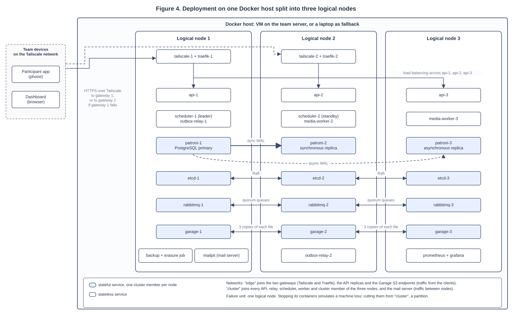
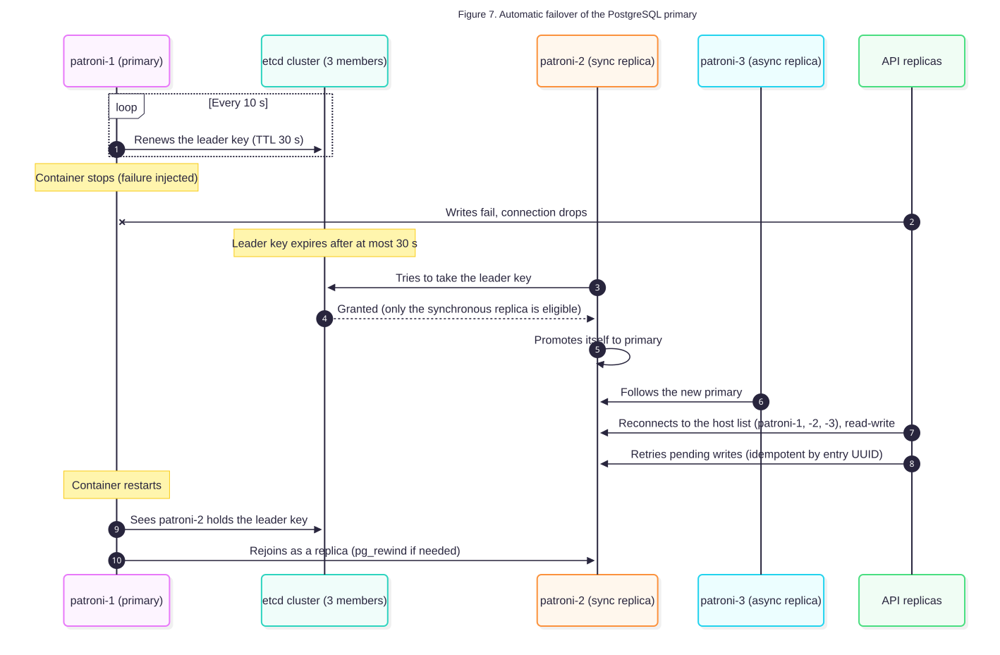
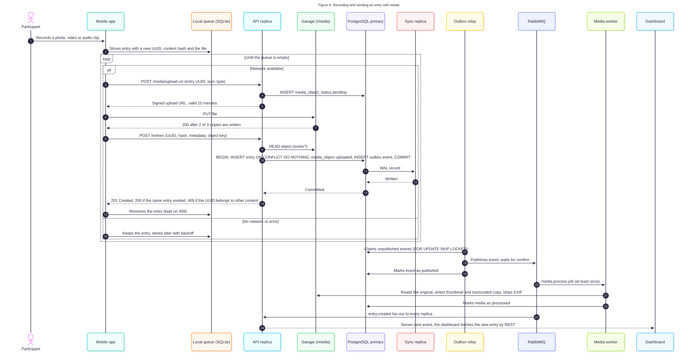

# Architecture

Status: implemented, 11 November 2026. The system described here runs on the team's server. The
architecture and the technology stack were approved by the Distributed Systems lecturer on
5 October 2026 and by the Projeto de Desenvolvimento de Software lecturer in a review of the
whole repository. What is not done is listed in [what is not done](#what-is-not-done).

## Why the system is distributed

An entry recorded in the moment cannot be collected again later. If the platform loses it, the
data point is gone, and in a two-week diary study a lost day can invalidate a participant. The
design follows from that and from four other facts:

- When an activity goes out to every participant at the same time, the answers arrive in a
  burst, many of them carrying photos, audio or video of several MB.
- A study runs for days or weeks without a maintenance window.
- The platform runs several studies at once, and researchers follow them in real time.
- Participants are out in the street with intermittent connectivity, so the phone has to keep
  entries and resend them, and the server has to accept resends without creating duplicates.

## Deployment

*Figure 3. Component architecture and data flows. Each box is a service type; the number of instances is in its label.*

*Figure 4. Deployment on one Docker host split into three logical nodes. Blue boxes are stateful cluster members; horizontal lines are replication between nodes.*

The whole stack runs on one Docker host with Docker Compose (`infra/deploy/compose.cluster.yaml`,
project `fieldnote-cluster`). The host is the virtual machine `fieldnote` on the team's homelab
server: Ubuntu 24.04, 5 cores, 10 GiB of memory, 60 GB of disk, included in the nightly backup of
the server's virtual machines. The 30 long-running containers used about 1.7 GiB when measured.
Cluster members find each other by Compose service name, never by IP address, so the clusters
survive container recreation. The laptop fallback is the development stack (`compose.yaml`, one
instance of each service); the cluster itself runs only on the server.

Inside that host the services are grouped into three logical nodes, which are container groups
with their own volumes, each with its own member of every cluster. They are not three machines:
they share one kernel, one Docker daemon, the CPU, the memory, the disk and the Docker networks.
Having the nodes on one host was approved by the Distributed Systems lecturer on 5 October 2026.
Stopping every container of a node simulates the loss of a machine, and that is the failure unit
of the [fault model](fault-model.md). The physical host, its Docker daemon and its disk are a
declared single point of failure. One virtual machine per node (a kernel, memory and disk of its
own for each, joined by an overlay network) is planned only for the final delivery of 20 December
2026; the Compose profiles `node1`, `node2` and `node3` are already organised for it.

*Figure 8. Components as built and the node each one runs on. Services connect to all three
members of a cluster (database host list, `rabbitmq` alias, Garage peers); the edges inside a node
show the local member.* Source: [components.mmd](diagrams/components.mmd).

| Node | Containers |
|---|---|
| 1 | `etcd1`, `pg1`, `rabbitmq1`, `garage1`, `api1`, `outbox-relay1`, `scheduler1`, `erasure-job1`, `backup1`, `traefik1`, `ts-gw1`, `mailpit-cluster`; one-shot `migrate` (schema upgrade) and `garage-cluster-init` (layout and bucket) |
| 2 | `etcd2`, `pg2`, `rabbitmq2`, `garage2`, `api2`, `outbox-relay2`, `scheduler2`, `media-worker2`, `traefik2`, `ts-gw2` |
| 3 | `etcd3`, `pg3`, `rabbitmq3`, `garage3`, `api3`, `media-worker3`, `prometheus`, `grafana` |

Node 3 has no gateway. Prometheus, Grafana, Mailpit, the erasure job and the backup run once, so
they are not replicated.

Access is only through Tailscale, a private network built on WireGuard. Each gateway is a
Tailscale container (`ts-gw1`, `ts-gw2`) beside a Traefik instance, with its own address on the
tailnet (`fieldnote-gw1.<tailnet>.ts.net` and `fieldnote-gw2.<tailnet>.ts.net`) and an HTTPS
certificate issued by Tailscale for that name. `ts-gw1` serves Traefik on port 443, Mailpit on
8443 and Grafana on 10000; `ts-gw2` serves Traefik on 443. No port is open to the Internet and
the containers publish ports on the host loopback only. Only the team's devices signed in to the
tailnet can reach the platform, a declared limitation of a proof of concept. A public deployment
would put one public hostname in front of the gateways and keep Tailscale for administration (see
`06_Dados_Investigacao/07-network-access-options.md`). The Tailscale containers run in userspace
mode and keep their login in a volume; the first login needs a link opened once by the owner of
the tailnet. The Tailscale coordination service is outside the fault model.

### Gateway failover

Entry failover is on the client. The app builds its requests against the list of gateway
addresses in `FIELDNOTE_API_BASE_URLS`, set at build time (`apps/mobile/src/api/failover.ts`). It
sends each request to the preferred gateway, the first of the list at start. On a network error
or an HTTP 502, 503 or 504 it sends the same request once to the next gateway, with 10 s per
attempt; the gateway that answers becomes the preferred one. A caller that cancelled the request
is not retried. The load generator uses the same rule. The dashboard has no failover of its own:
the API serves it through whichever gateway the browser opened, so after a gateway failure the
user opens the other address.

Upload URLs are signed for one public endpoint (`FIELDNOTE_MEDIA_PUBLIC_ENDPOINT`, the node 1
gateway), so an entry that carries media cannot start an upload while gateway 1 is down, and the
phone cannot switch that URL. Text entries switch. The API itself reaches object storage through
the `s3-gateway` alias that both Traefik instances answer to, so it works with either gateway.

### Dashboard

The dashboard is a React single-page application built into the API image. The API replicas serve
its files, with a fallback to `index.html` for client routes, and Traefik sends every path that is
not `/api` or `/media` to the API. Hashed asset names are cached for a year and `index.html` is
not cached.

### Networks

| Network | Members | Purpose |
|---|---|---|
| `edge` | The two Traefik instances, `ts-gw2`, the API replicas, the media workers, Prometheus | Traffic from the clients and to object storage through the gateways |
| `cluster` | Every API, relay, scheduler, worker and cluster member of the three nodes, `ts-gw1`, Mailpit, Grafana, Prometheus | Traffic between nodes: database, etcd, RabbitMQ, Garage replication |

A network partition is simulated by disconnecting every container of one node from `cluster`.
The isolated node can no longer reach the other two, its API replica fails its health check and
Traefik stops sending it requests. On one host only a split of one node against two can be
tested; packet loss and latency are not simulated. The partition test (scenario 7) passed on the server.

## Components

| Component | Technology | Instances | Role |
|---|---|---|---|
| Participant app | React Native with Expo, TypeScript | One per phone | Receives activities, records entries, keeps an offline queue in SQLite |
| Researcher and admin dashboard | React with Vite, TypeScript | Served by the API replicas | Studies, activities, participants, entries, export, administration |
| Access | Tailscale | 2 containers, one beside each Traefik, on nodes 1 and 2 | Encrypted access for the team's devices without opening ports to the Internet, and an HTTPS certificate for each gateway address. The app knows both addresses and switches to the second when the first fails |
| Gateway | Traefik | 2, on nodes 1 and 2 | Routes `/api` and the dashboard to the API replicas and `/media` to object storage, load balancing and health checks. Hides `/api/v1/metrics`. Rate limiting is not configured |
| API | Python 3.12, FastAPI | 3, one per node | REST API, signed upload URLs, server-sent events to dashboards, the dashboard files. The outbox relay runs as its own container on nodes 1 and 2, and a periodic erasure job on node 1 |
| Scheduler | Python | 2, on nodes 1 and 2, one active (lease in the database) | Plans activity prompts with a constraint solver (see [scheduler](scheduler.md)) and sends push notifications |
| Media worker | Python with ffmpeg | 2, on nodes 2 and 3 | Thumbnails, conversion of videos to one common format, removal of metadata (including GPS) from photos, videos and audio. ffmpeg is an open-source command-line tool that reads and converts audio and video files; phones record video in different formats and sizes, and converting them to H.264 MP4 at a smaller resolution makes every video play in the dashboard and take less storage |
| Database | PostgreSQL 17 with Patroni and etcd | 3 of each, one per node | Relational data, automatic failover |
| Message broker | RabbitMQ with quorum queues | 3, one per node | Jobs for the media worker, events for dashboards |
| Object storage | Garage (S3 compatible) | 3, one per node | Photos, audio and video, 3 copies of every file. Each logical node is its own zone in the Garage layout, so the 3 copies land on 3 logical nodes. The 3 zones share one physical host, so Garage does not protect against losing the host, a declared single point of failure |
| Backup | Python, AES-256-GCM | 1, on node 1 | Once a day writes an encrypted archive of a database dump and of the media bucket to a `backups` bucket in Garage and keeps 7 days. It leaves out participants whose erasure is pending and reads Garage on node 1 directly. The key is a 32-byte file mounted from the host, outside the images and the repository |
| Monitoring | Prometheus and Grafana | 1 each, on node 3 | Metrics and one provisioned Grafana dashboard, reached on the tailnet through gateway 1 (port 10000). No alert rules are defined. Not replicated |
| Mail server | Mailpit in the course project, any SMTP server in production | 1, on node 3, not replicated | Sends the 6-digit codes of the optional participant account and the single-use links for team accounts by SMTP. Mailpit is a local mail catcher: it keeps the mail and delivers none, so no real mail is sent and no paid service is used. The API reaches it on the `cluster` network and its web page is served on the tailnet through gateway 1 (port 8443). Account emails are the only mail the platform sends. A mail failure stops email sign-in and nothing else |
| Push notifications | Expo Push (FCM underneath) | External service | Delivers activity notifications to phones |

## Language

The participant app's interface texts and the consent text are available in Portuguese, because the participants are mostly in Portugal (see `00-research-context-unidcom.md` in the research files). English is the second language. The language of each participant is stored in `participant.locale`, with the values `pt` and `en` (see [data model](data-model.md)).

## How each layer tolerates failure

| Layer | Replication | Failure detection | Recovery |
|---|---|---|---|
| Client | Every phone is independent | The app sees a network error or a timeout | The entry stays in the local queue and is resent with the same UUID |
| Entry | 2 gateways, each with Tailscale and Traefik | The client's request fails with a network error, a 502, 503 or 504, or after 10 s | The app repeats the request once on the other gateway |
| API | 3 stateless replicas | Traefik calls `/api/v1/health/ready` every 2 s with a 1 s timeout. It answers 503 if the replica cannot reach the database primary or a broker | Traefik stops routing to the failed replica. Docker restarts a crashed container |
| Scheduler | 2 replicas, one leader | The leader renews a lease row in the database every 5 s. A lease not renewed for 15 s has expired | The standby takes the expired lease and continues from the plan stored in the database. Measured takeover: 13.5 s on average over four runs (12.3 to 15.2 s) |
| Database | 1 primary, 1 synchronous replica, 1 asynchronous replica | The primary stops renewing its leader key in etcd (TTL 30 s) | Patroni promotes the synchronous replica. The old primary rejoins as a replica |
| Broker | 3 nodes, quorum queues | The RabbitMQ cluster loses a member | Queues keep working with 2 of 3 members. Unacknowledged messages are delivered again |
| Object storage | 3 copies, one per zone, writes confirmed after 2 | Garage nodes stop seeing the member | Reads and writes continue with 2 nodes. The returning node catches up |

*Figure 7. Automatic failover of the PostgreSQL primary.*

## Consistency decisions

### Client-generated identifiers

Every entry gets a UUID on the phone before it is sent, together with a SHA-256 hash of its
content. The API inserts with `ON CONFLICT DO NOTHING`. When the UUID already exists, the API
checks that the existing row belongs to the same participant and has the same hash: if it does,
the resend was a duplicate and the API answers 200; if it does not, the API answers 409 and the app
keeps the entry in its queue and reports the problem. Entries that arrive late from the offline
queue are accepted with their original `recorded_at`; they are never rejected for arriving after
the activity window. Delivery is at least once and the stored
result is exactly once.

### File first, metadata second

When the app asks for an upload URL, the API creates a `media_object` row with status `pending`
and returns a signed URL valid for 10 minutes, which also signs the maximum size and the content
type, so object storage enforces them. The app sends the file straight to object storage through
the `/media` route of the gateway. If the
upload fails, the app asks for a new URL. When the app confirms the entry, the API checks that the
object exists before committing. Objects still `pending` after 7 days are meant to be deleted, long
enough for a phone that stays offline for several days; that cleanup is not implemented yet. Video entries are limited to 2 minutes.

### Synchronous replication

The database runs Patroni with `synchronous_mode: true`, `synchronous_mode_strict: true` and one
synchronous standby. The API only confirms an entry after it is written on two database nodes. In
synchronous mode Patroni only promotes a replica recorded as synchronous, so a failover never
picks a replica that could be missing confirmed entries. If the synchronous replica fails, Patroni
makes the other replica synchronous; with strict mode, writes wait during that switch instead of
being confirmed on one node only.

Patroni's documentation warns that a transaction can still be lost in strict mode if the wait
for the replica is cancelled, because the commit is already written on the primary. The API
therefore confirms an entry only after the commit has returned successfully, sets no timeout that
could cancel that wait, and reports any other outcome to the app as a failure. The app resends with
the same UUID, which the idempotent insert resolves either way (see
`06_Dados_Investigacao/05-fault-tolerance-foundations.md`).

### Transactional outbox

The API writes the entry and an `entry.created` event in the same database transaction. A relay, its own container next to the API replicas on nodes 1 and 2, claims unpublished events with `SELECT ... FOR UPDATE SKIP LOCKED`,
publishes them to RabbitMQ with publisher confirms and marks them as published. If the broker is
down, events wait in the database. A relay that publishes and crashes before marking the event
publishes it again, so consumers treat events as at least once and ignore ids they have already
processed. Events can be published out of order across relays; nothing depends on their order.
Published events are meant to be deleted after 7 days; the purge is not implemented, so they stay in the table.

### Database connections

The API connects with the host list `pg1,pg2,pg3` and `target_session_attrs=read-write` (a standard PostgreSQL
client option), with a 3 s connect timeout, so after a failover it finds the new primary without
a proxy in front of the database. The connection pool checks connections before use and is
emptied when a write fails with a connection error. The API retries the whole transaction up to 3
times; the retry is safe because every write is idempotent. A primary cut off from etcd demotes
itself to read-only when its leader key expires, so it stops accepting writes.

A multi-host connection string with `target_session_attrs` is a libpq feature, which psycopg 3 supports. On the server a failover of the primary took 27.2 s on average over four runs (23.8 to 31.4 s), inside the Patroni target of 45 s.

### Real time

Each API replica keeps the server-sent event connections of the dashboards it serves and receives
every event from a RabbitMQ fan-out exchange. The events tell the dashboard what changed; the data
comes from the REST API. When a connection drops, because a replica or a gateway failed,
the dashboard reconnects after a random delay of 1 to 5 s and reloads the entries received since
the last one it showed, removing duplicates by entry id. The API sends a comment line every 20 s
so that idle connections are not closed, with `Cache-Control: no-store` and no compression.

### Notifications

Push notifications depend on an external service that delivers on a best-effort basis, without a
service level agreement. Scheduled local notifications as a fallback are not implemented: the app
does not schedule any. When a push does not arrive, participants still get their activities,
because the app asks the API for pending prompts every time it opens.

*Figure 6. Recording and sending an entry with media, including the offline queue and the outbox.*

## What is not done

- One virtual machine per node: the nodes are logical, on one VM, until the final delivery.
- Scenario 8 of the fault model (phone in airplane mode) passed on the Android emulator; it has not been run on a physical phone.
- Rate limiting at the gateways is not configured; only the API throttles logins and account sign-in codes.
- Cleanup of orphan media objects (`pending` after 7 days) and the purge of published outbox events.
- Prometheus has no alert rules.
- The fixed-time baseline of the scheduler is not a service feature; it lives in the evaluation (see [scheduler](scheduler.md)).

## Related documents

- [Fault model](fault-model.md)
- [Data model](data-model.md)
- [Scheduler](scheduler.md)
- [Security](security.md)
